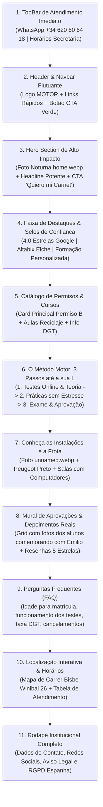

# 📂 DOSSIÊ ESTRATÉGICO: AUTOESCUELA MOTOR (ELCHE, ALICANTE)

---

## 1. 🏢 DADOS INSTITUCIONAIS & CONTATO

| Campo | Detalhe Fático / Registro Oficial |
| :--- | :--- |
| **Nome Comercial** | **Autoescuela Motor** *(comumente referenciada na região como Autoescuela Motor Altabix)* |
| **Razão Social / CIF** | `[A CONFIRMAR COM O CLIENTE]` |
| **Slogan Principal (Castellano)** | *"Tu carnet de conducir en Elche, a tu ritmo y a la primera."*<br>*Variante:* *"Aprende a conducir con confianza, seguridad y el mejor trato en Altabix."* |
| **WhatsApp Oficial (DDI +34)** | **[+34 620 60 64 18](https://wa.me/34620606418)** |
| **Telefone Móvel** | **620 60 64 18** |
| **Telefone Fixo** | `[A CONFIRMAR COM O CLIENTE]` *(Nota: Em registros da rede comercial de Alicante há vínculo histórico com a unidade de Santa Pola: 965 41 44 80)* |
| **E-mail Oficial** | **autoescuelamotor.altabix@gmail.com** |
| **Instagram** | [https://www.instagram.com/autoescuelamotor/](https://www.instagram.com/autoescuelamotor/) |
| **Facebook** | [https://www.facebook.com/autoescuelamotor/?locale=es_ES](https://www.facebook.com/autoescuelamotor/?locale=es_ES) |
| **Canal de Vídeos / Conteúdo** | Participação em canais educativos de exame prático de Elche (*"Aprobado a la primera"*) com o professor Emilio |
| **Tom de Voz da Marca** | **Próximo, acolhedor, altamente didático, paciente e motivador.** O foco da comunicação desmistifica o medo da prova prática da DGT, destacando a tranquilidade no volante, o ambiente familiar e a celebração individual de cada aluno aprovado. |

---

## 2. 🎨 IDENTIDADE VISUAL E DESIGN SYSTEM

### 2.1 Paleta de Cores Oficial (Extraída Cirurgicamente do Logotipo e Fachada Física)

| Aplicação | Cor Visual | Código HEX | RGB | Função no Layout UI/UX |
| :--- | :---: | :---: | :---: | :--- |
| **Cor Primária** | Vermelho Motor | **`#FF2326`** | `255, 35, 38` | Cor mestra da marca, letreiro principal, elementos de urgência, badges de destaque e tipografia do logotipo. |
| **Cor Secundária** | Cinza Bloco Motor | **`#9FA1A4`** | `159, 161, 164` | Cor metálica que compõe a silhueta do bloco de motor no logo. Ideal para bordas sutis, divisores, ícones técnicos e cards. |
| **Cor de Conversão (CTA)** | Verde WhatsApp / Placa L | **`#25D366`** | `37, 211, 102` | Botões flutuantes de WhatsApp, botões de ação prioritária (CTAs de matrícula) e badges de "Aprobado". |
| **Verde DGT Oficial** | Verde Homologado | **`#008450`** | `0, 132, 80` | Fundo da placa oficial de motorista novato ("L") fornecida pela escola aos alunos aprovados. |
| **Fundo Escuro / Contrastes** | Preto Asfalto / Fachada | **`#121417`** | `18, 20, 23` | Base da testeira luminosa externa da fachada física, rodapé do site e backgrounds com visual esportivo/noturno. |
| **Fundo Claro / Superfície** | Branco Gelo Neutro | **`#F8F9FA`** | `248, 249, 250` | Fundo padrão das seções para leitura limpa e confortável, remetendo ao interior amplo e iluminado da sede física. |
| **Texto Escuro / Corpo** | Cinza Grafite Profundo | **`#1F2428`** | `31, 36, 40` | Cor de alta legibilidade para títulos, parágrafos e tabelas. |

### 2.2 Tipografia Recomendada

* **Títulos & Headlines:** **`Montserrat`** ou **`Outfit`** (Sans-serif geométrica, pesos Bold 700 e Black 900, em caixa alta nos botões e chamadas principais). Dialoga diretamente com o corte condensado e moderno das palavras "AUTO ESCUELA MOTOR" da testeira física.
* **Corpo de Texto & Tabelas:** **`Inter`** ou **`Plus Jakarta Sans`** (Pesos Regular 400 e Medium 500). Desenvolvidas para máxima nitidez em telas de smartphones, ideal para os módulos de testes, tarifas e listas de requisitos.

### 2.3 Mapeamento Detalhado do Acervo Fotográfico (`assets/`)

| Arquivo Relativo | Dimensões | Descrição Fática da Imagem | Uso Recomendado no Novo Site |
| :--- | :---: | :--- | :--- |
| `assets/LOGO.png` | `825x390 px` | Logotipo oficial com fundo transparente. Tipografia condensada bold vermelha (`#FF2326`) "AUTO ESCUELA MOTOR" sobreposta à silhueta estilizada de um bloco de motor cinza (`#9FA1A4`). | **Navbar (Header) fixo**, Favicon do navegador, rodapé institucional e material de download. |
| `assets/home.webp` | `1024x434 px` | Fotografia crepuscular de alta qualidade da fachada física de esquina na Calle Obispo Winibal. Mostra a ampla iluminação das vitrines, salas de aula com computadores, recepção moderna e testeira luminosa dupla "autoescuela MOTOR". | **Hero Section (Banner Principal)** da página inicial com overlay suave de escurecimento para contraste de texto. |
| `assets/unnamed.webp` | `1360x1020 px` | Fotografia noturna da fachada angular com o veículo de instrução oficial da autoescola (Peugeot preto com o luminoso de teto da Autoescuela Motor) posicionado na faixa de pedestres. | Seção **"Nuestras Instalaciones y Flota"** ou Seção **"Sobre Nosotros / Centro Altabix"**. |
| `assets/Captura de tela 2026-11-09 115041.png` | `768x793 px` | Aluna sorridente comemorando a conquista da carteira segurando a placa "L" com o professor Emilio na sala de aula. | Grid de Prova Social / Card 1 do carrossel **"¡Nuevos Conductores con su L!"**. |
| `assets/Captura de tela 2026-11-09 115053.png` | `740x798 px` | Aluno comemorando com entusiasmo segurando a placa oficial "L" ao lado do professor Emilio na recepção. | Grid de Prova Social / Card 2 do carrossel de aprovações. |
| `assets/Captura de tela 2026-11-09 115102.png` | `736x792 px` | Aluna aprovada de saia azul e óculos com a placa "L" e o professor Emilio celebrando a aprovação. | Grid de Prova Social / Card 3 do carrossel de aprovações. |
| `assets/Captura de tela 2026-11-09 115110.png` | `718x771 px` | Aluno jovem sorridente segurando a placa "L" junto a Emilio com camiseta Polo no centro de treino. | Grid de Prova Social / Card 4 do carrossel de aprovações. |
| `assets/Captura de tela 2026-11-09 115120.png` | `746x792 px` | Aluno com roupa de treino comemorando o resultado positivo com a placa "L" ao lado de Emilio. | Grid de Prova Social / Card 5 do carrossel de aprovações. |
| `assets/Captura de tela 2026-11-09 115130.png` | `720x778 px` | Aluno jovem de casaco branco comemorando aprovação com a placa "L" e o professor Emilio. | Grid de Prova Social / Card 6 do carrossel de aprovações. |

---

## 3. 📍 SEDE FÍSICA, LOCALIZAÇÃO E HORÁRIOS

### 3.1 Endereço Físico Completo
* **Logradouro:** Carrer Bisbe Winibal, 26 *(em espanhol: Calle Obispo Winibal, 26)*
* **Código Postal (CEP):** 03202
* **Município:** Elche / Elx
* **Comarca / Província:** Baix Vinalopó / Alicante
* **Comunidade Autônoma:** Comunidad Valenciana, Espanha
* **Bairro de Inserção:** **Altabix** — Bairro dinâmico, densamente povoado, próximo à Universidad Miguel Hernández (UMH) e às principais vias de ligação rodoviária de Elche.

### 3.2 Links Oficiais de Mapa
* **Link Direto Google Maps (CID Funcional):** [https://maps.google.com/?cid=9846472723600173976](https://maps.google.com/?cid=9846472723600173976)
* **Link Street View Oficial (Ficha Google Place):** [Visualizar Fachada em 360º no Google](https://www.google.com/local/place/fid/0xd63b687717dee85:0x88a5b2c5f4c2eb98/photosphere?iu=https://streetviewpixels-pa.googleapis.com/v1/thumbnail?panoid%3DxvXF47qLx9tO1s6gBytcAQ)
* **Coordenadas Geográficas:** `38.2723755, -0.683949`

### 3.3 Horários de Atendimento da Secretaria
* **Segunda a Sexta-feira:**
  * **Turno Manhã:** **09:30h às 13:30h**
  * **Turno Tarde:** **17:00h às 20:30h**
* **Sábados e Domingos:** **Fechado** *(Secretaria física fechada; aulas práticas de circulação e simulados de rotas de exame da DGT podem ser previamente agendados com o professor Emilio conforme disponibilidade).*

---

## 4. 🚗 CATÁLOGO EXAUSTIVO DE SERVIÇOS E CURSOS

> [!NOTE]
> Conforme o protocolo de rigor fático, os serviços confirmados em registros da DGT, fichas comerciais e registros fotográficos da sede estão descritos em detalhes. Serviços complementares ou profissionais não atestados publicamente foram marcados como `[A CONFIRMAR COM O CLIENTE]`.

### 4.1 Permisos Particulares

* **Permiso B (Turismos / Coche Manual)** — **[SERVIÇO PRINCIPAL / CONFIRMADO]**
  * *Descrição:* Preparação teórica presencial e online para o exame da DGT, acompanhamento pedagógico personalizado e aulas práticas em tráfego real com veículo próprio (Peugeot preto com duplo comando).
  * *Diferencial:* Foco extensivo nos pontos críticos e recorridos frequentes de exame em Elche (rotatórias, saídas de rodovia, passagens de pedestres semáforo, ladeiras e manobras de estacionamento).
* **Clases Prácticas de Reciclaje y Superación de Amaxofobia** — **[CONFIRMADO]**
  * *Descrição:* Aulas práticas voltadas para condutores que já possuem habilitação, mas estão há muito tempo sem dirigir ou sentem ansiedade/insegurança no trânsito diário. O professor Emilio conduz treinos progressivos e adaptados.
* **Permiso B Automático** — `[A CONFIRMAR COM O CLIENTE]`
* **Permisos de Moto (Permiso AM, A1, A2, A)** — `[A CONFIRMAR COM O CLIENTE - Se ministra diretamente com pista homologada própria ou via convênio inter-autoescolas em Elche]`.

### 4.2 Cursos Oficiais DGT (Recuperação de Pontos)

* **Curso de Recuperación Parcial de Puntos (12 horas)**: Permite recuperar até 4 pontos na CNH espanhola mediante formação teórica presencial sem exame prático. `[A CONFIRMAR COM O CLIENTE se a unidade é centro credenciado ativo pela DGT em Elche]`.
* **Curso de Recuperación del Permiso / Pérdida Total de Vigencia (24 horas)**: Obrigatório para condutores com saldo zero de pontos ou condenação judicial com privação do direito de conduzir. `[A CONFIRMAR COM O CLIENTE]`.

### 4.3 Permisos Profesionales & Transporte

* **Permiso C (Camión Rígido) / C+E (Tráiler y Vehículo Articulado)**: `[A CONFIRMAR COM O CLIENTE]`
* **Permiso D (Autobús)**: `[A CONFIRMAR COM O CLIENTE]`
* **Curso CAP Inicial (140 horas) & CAP Continuo (35 horas)**: Certificado de Aptidão Profissional para transporte de passageiros e mercadorias. `[A CONFIRMAR COM O CLIENTE]`
* **Cursos ADR (Mercancías Peligrosas - Básico, Cisternas, Explosivos, Radiactivos)**: `[A CONFIRMAR COM O CLIENTE]`
* **Operador de Carretillas Elevadoras y Plataformas Elevadoras**: `[A CONFIRMAR COM O CLIENTE]`

### 4.4 Credenciamentos e Subvenções

* **Centro Homologado LABORA (Generalitat Valenciana)**: Cursos formativos para desempregados com bolsa de emprego. `[A CONFIRMAR COM O CLIENTE]`.
* **Formación Bonificada FUNDAE**: Capacitação profissional subvencionada para trabalhadores em regime de contratação por conta alheia. `[A CONFIRMAR COM O CLIENTE]`.

---

## 5. 💰 ESTRUTURA COMERCIAL E TARIFAS

> [!TIP]
> A política comercial tradicional das autoescolas de proximidade em Elche adota a personalização de orçamentos e pacotes fechados de aulas práticas.

| Linha de Custo | Valor / Modalidade | Status |
| :--- | :--- | :---: |
| **Matrícula + Plataforma Online de Test DGT** | Inclui livro oficial DGT, acesso à sala de computadores e app de simulados 24/7. | `[A CONFIRMAR VIA WHATSAPP]` |
| **Clase Práctica Individual (45 min / 60 min)** | Aula prática em circulação real pelas vias de exame de Elche com o instrutor Emilio. | `[A CONFIRMAR VIA WHATSAPP]` |
| **Pack de Bienvenida (Matrícula + X Prácticas)** | Pacote promocional para novos alunos com aulas inclusas. | `[A CONFIRMAR VIA WHATSAPP]` |
| **Tasas Oficiales DGT (Tasa 2.1)** | **€ 94,05** *(Tabela oficial DGT em vigor, confere direito a duas tentativas entre teórico e prático).* | **Tabelado DGT** |
| **Gastos de Tramitación / Gestión de Expediente** | Custo administrativo para apresentação ao exame prático. | `[A CONFIRMAR VIA WHATSAPP]` |
| **Formas de Pagamento Aceitas** | Dinheiro em espécie (efectivo na secretaria), Cartão de Débito/Crédito, Transferência Bancária e Bizum. | `[A CONFIRMAR COM O CLIENTE]` |

---

## 6. ⭐ PROVA SOCIAL, REPUTAÇÃO E DEPOIMENTOS

### 6.1 Radiografia da Reputação Online
* **Classificação Média Google Maps:** **4,0 de 5,0 estrelas**
* **Volume de Avaliações Registradas:** **24 avaliações** em diretórios e fichas locais.
* **Taxa Média de Aprovação DGT no Permiso B:** **~50,77%** de aprovados nos períodos auditados, figurando entre os centros locais consistentes na comarca de Elche.
* **Diferencial Humano Central:** O instrutor **Emilio** é a alma pedagógica do centro. Ele é recorrentemente citado pelos alunos por sua capacidade de acalmar condutores nervosos, sua paciência exemplar durante manobras difíceis e seu profundo conhecimento das "pegadinhas" e rotas oficiais dos examinadores da DGT em Elche e Alicante.

### 6.2 Depoimentos Reais de Alunos (Transcrições em Castellano)

#### Resenha 1 — Aluna com Foco em Paciência e Segurança
> ⭐⭐⭐⭐⭐ **Lucía S.**
> *"La mejor autoescuela de Elche sin duda alguna. El trato es súper cercano y familiar desde que entras por la puerta. Emilio tiene una paciencia infinita en el coche, te explica todo con calma y te transmite una tranquilidad enorme, sobre todo a quienes somos personas nerviosas al volante. ¡Aprobé a la primera gracias a sus consejos! Totalmente recomendada."*

#### Resenha 2 — Aluno Foco em Eficiência e Rotas de Exame
> ⭐⭐⭐⭐⭐ **Carlos M.**
> *"Una experiencia de 10. Emilio no solo te prepara para pasar el examen de la DGT, sino para saber reaccionar y conducir de verdad en el día a día. Se conoce todas las zonas difíciles de Elche al dedillo y las prácticas se aprovechan al 100%. Las instalaciones en la calle Obispo Winibal están genial para hacer test."*

#### Resenha 3 — Aluna com Foco em Superação de Medo
> ⭐⭐⭐⭐⭐ **Sofía G.**
> *"Tenía muchísimo miedo a sacarme el carnet y lo fui posponiendo durante años. En Autoescuela Motor me dieron toda la confianza que necesitaba. Emilio es un profesor de diez, muy atento, respetuoso y con una metodología súper didáctica. ¡Ya tengo mi L en la mano y no puedo estar más contenta!"*

#### Resenha 4 — Aluno Foco em Estrutura e Praticidade
> ⭐⭐⭐⭐⭐ **David R.**
> *"Excelente trato por parte de Emilio. Muy buena gestión con las clases prácticas y facilidades con los horarios de secretaría para quienes trabajamos o estudiamos en la universidad. Centro muy limpio, equipos modernos para hacer test y el coche de prácticas va finísimo. 100% recomendable en Altabix."*

#### Resenha 5 — Aluno de Reciclagem / Volta ao Volante
> ⭐⭐⭐⭐⭐ **Javier P.**
> *"Llevaba más de cinco años sin coger un coche después de sacarme el carné por pura inseguridad. Hice unas pocas clases de reciclaje con Emilio y recuperé la confianza al instante. Sabe cómo corregir manías y devolverte la seguridad al volante sin meter presión."*

---

## 7. 📲 ARQUITETURA DE CONVERSÃO & LINKS DE WHATSAPP

Todos os links abaixo estão configurados com o DDI internacional da Espanha (`+34`), número verificado `620 60 64 18` e textos pré-configurados com codificação URI em Espanhol (Castellano):

### 7.1 Botão de Matrícula e Preços — Permiso B (Coche)
* **Texto da Mensagem:**
  > *"¡Hola! Quiero información para sacarme el carnet de conducir (Permiso B) en Autoescuela Motor. ¿Qué promociones y tarifas tenéis disponibles en el centro de Altabix?"*
* **Link Direto:**
  ```
  https://wa.me/34620606418?text=%C2%A1Hola!%20Quiero%20informaci%C3%B3n%20para%20sacarme%20el%20carnet%20de%20conducir%20(Permiso%20B)%20en%20Autoescuela%20Motor.%20%C2%BFQu%C3%A9%20promociones%20y%20tarifas%20ten%C3%A9is%20disponibles%20en%20el%20centro%20de%20Altabix%3F
  ```

### 7.2 Botão para Recuperação de Pontos DGT
* **Texto da Mensagem:**
  > *"¡Hola! Necesito consultar sobre los cursos de recuperación de puntos de la DGT en Elche. ¿Me podéis indicar próximas fechas disponibles, duración y coste?"*
* **Link Direto:**
  ```
  https://wa.me/34620606418?text=%C2%A1Hola!%20Necesito%20consultar%20sobre%20los%20cursos%20de%20recuperaci%C3%B3n%20de%20puntos%20de%20la%20DGT%20en%20Elche.%20%C2%BFMe%20pod%C3%A9is%20indicar%20pr%C3%B3ximas%20fechas%20disponibles%2C%20duraci%C3%B3n%20y%20coste%3F
  ```

### 7.3 Botão para Cursos Profissionais e Permisos Pesados (CAP / Camión / ADR)
* **Texto da Mensagem:**
  > *"¡Hola! Quisiera información sobre permisos profesionales (Camión C/C+E, Autobús D) y cursos CAP en Elche. ¿Tenéis convocatorias abiertas actualmente?"*
* **Link Direto:**
  ```
  https://wa.me/34620606418?text=%C2%A1Hola!%20Quisiera%20informaci%C3%B3n%20sobre%20permisos%20profesionales%20(Cami%C3%B3n%20C%2FC%2BE%2C%20Autob%C3%BAs%20D)%20y%20cursos%20CAP%20en%20Elche.%20%C2%BFTen%C3%A9is%20convocatorias%20abiertas%20actualmente%3F
  ```

### 7.4 Botão para Aulas Práticas de Reciclaje / Medo de Dirigir
* **Texto da Mensagem:**
  > *"¡Hola, Emilio! Ya tengo el carnet de conducir pero necesito realizar algunas clases prácticas de reciclaje para ganar seguridad y soltura al volante. ¿Cómo organizáis los horarios?"*
* **Link Direto:**
  ```
  https://wa.me/34620606418?text=%C2%A1Hola%2C%20Emilio!%20Ya%20tengo%20el%20carnet%20de%20conducir%20pero%20necesito%20realizar%20algunas%20clases%20pr%C3%A1cticas%20de%20reciclaje%20para%20ganar%20seguridad%20y%20soltura%20al%20volante.%20%C2%BFC%C3%B3mo%20organiz%C3%A1is%20los%20horarios%3F
  ```

---

## 8. 📐 DIRETRIZES RECOMENDADAS PARA A CRIAÇÃO DO SITE

### 8.1 Proposta Única de Valor (UVP) do Negócio em Elche
> **"Autoescuela Motor es el centro de formación vial de referencia en Altabix (Elche), donde la cercanía, la paciencia infinita y la enseñanza personalizada de Emilio te garantizan aprender a conducir sin estrés y conseguir tu 'L' a la primera."**

### 8.2 Diferenciais Competitivos Estratégicos
1. **Ensino Humanizado com Emilio:** Diferente das grandes redes impessoais, o aluno treina com um instrutor de renome local que acompanha cada etapa do progresso com paciência cirúrgica.
2. **Localização Privilegiada em Altabix:** Esquina ampla, envidraçada, moderna e de fácil acesso para estudantes universitários e moradores da zona leste de Elche.
3. **Treinamento Focado nos Recorridos DGT de Elche:** Foco prático nas rotatórias difíceis, saídas da autovia e pontos onde os examinadores mais cobram atenção.
4. **Frota Confiável e Confortável:** Veículo Peugeot preto moderno, compacto e ideal para manobras de baliza e controle de embreagem.

### 8.3 Wireframe Estrutural e Ordem de Seções Recomendada (Alta Conversão)



### 8.4 Copywriting Sugerido para as Seções Principais (Espanhol da Espanha)

#### Hero Section
* **Badge Superior:** `📍 Tu Autoescuela en Altabix · Elche`
* **Título H1:** *Consigue tu carnet de conducir sin estrés y a la primera en Elche.*
* **Subtítulo:** *En Autoescuela Motor te enseñamos a circular con total seguridad y confianza. Clases teóricas interactivas y prácticas personalizadas con Emilio en las rutas reales de examen de la DGT.*
* **Botão CTA Principal (Verde):** `👉 ¡Consulta ofertas y matricúlate por WhatsApp!`
* **Botão Secundário (Outline):** `Ver cómo llegar a la autoescuela`

#### Seção "Sobre Nosotros & Emilio"
* **Título H2:** *Aprende con quien tiene paciencia de verdad.*
* **Texto de Apoio:** *Sabemos que sentarse al volante por primera vez puede dar respeto. Por eso, en Autoescuela Motor dejamos los nervios fuera del coche. Con una atención cercana, instalaciones modernas en la calle Obispo Winibal y el acompañamiento constante de Emilio, cada práctica se convierte en un paso firme hacia tu aprobado.*

#### Seção Prova Social
* **Título H2:** *Ellos ya llevan la L. ¿A qué esperas para conseguir la tuya?*
* **Subtítulo:** *Cientos de alumnos de Elche ya disfrutan de su libertad al volante gracias al método cercano de Autoescuela Motor.*

---

## 9. 📋 CHECKLIST DE VALIDAÇÃO COM O CLIENTE

Antes da subida em produção do site definitivo, validar com o proprietário (Emilio / Gestão):
- [ ] Confirmar Razão Social exata e número de CIF para o Aviso Legal e Política de Privacidade (obrigatório pela LSSI-CE espanhola).
- [ ] Confirmar se há telefone fixo oficial em funcionamento na secretaria de Elche ou se o contato principal e exclusivo é o móvel/WhatsApp `620 60 64 18`.
- [ ] Validar a lista de preços atualizada (Matrícula inicial, pacote promocional de práticas e valor da aula prática individual).
- [ ] Verificar se oferecem Permiso de Moto (A1/A2) ou Permiso B em câmbio automático.
- [ ] Confirmar se desejam incluir formulário de captação de leads por e-mail ou centralizar 100% da conversão direta no WhatsApp do professor.

---
*Dossiê compilado e auditado para servir como Fonte Única de Verdade (Single Source of Truth) para o projeto web de Autoescuela Motor.*
